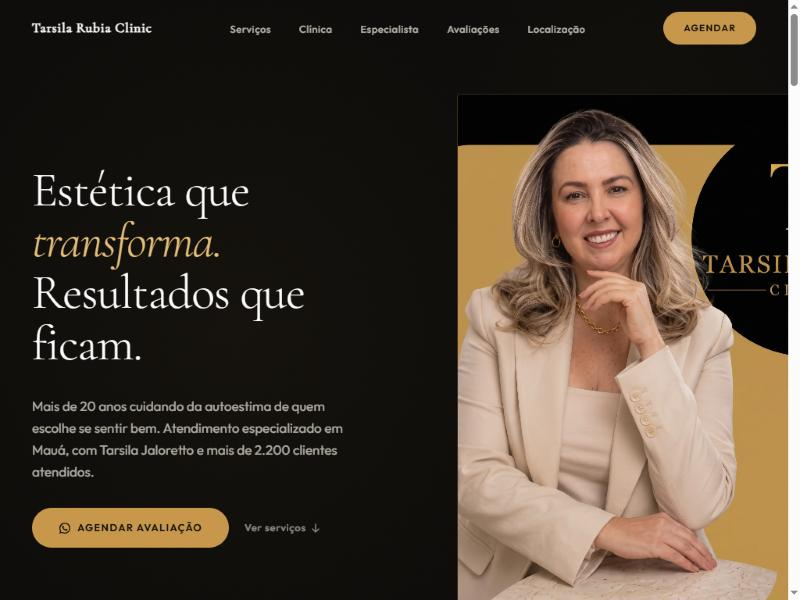

# Tarsila Rubia Clinic



Site one-page institucional da **Tarsila Rubia Clinic** — clínica de estética em Mauá, SP.

---

## Estrutura de arquivos

```
TarsilaRubia/
├── index.html
├── 404.html
├── robots.txt
├── sitemap.xml
├── llms.txt
├── README.md
├── .gitignore
└── assets/
    ├── styles.css          ← tokens :root, animações, componentes
    ├── app.js              ← GoatCounter, menu mobile, scroll-reveal
    ├── tailwind-config.js  ← configuração do Tailwind CDN
    ├── logo.*
    └── img/
        ├── tarsila-hero-nova.jpg     ← hero (1080×1080)
        ├── tarsila-especialista.png  ← seção especialista
        ├── clinica-recepcao.jpg      ← galeria clínica
        ├── clinica-salas-atendimento.jpg
        ├── clinica-entrada.jpg
        ├── clinica-administrativo.jpg
        ├── og-image.jpg              ← Open Graph 1200×630
        ├── favicon.svg / .ico / favicon-32x32.png / apple-touch-icon.png
        └── hero-preview.png          ← captura para este README
```

---

## Seções

| Âncora | Seção |
|---|---|
| `#hero` | Hero — proposta de valor e CTA principal |
| `#servicos` | Nossos Serviços — 8 tratamentos em grid |
| `#clinica` | Sobre a Clínica — diferenciais + galeria 2×2 |
| `#especialista` | A Especialista — Tarsila Jaloretto |
| `#avaliacoes` | Avaliações — reviews reais do Google |
| `#localizacao` | Localização & Horários — mapa + horários |
| `#contato` | CTA Final — agendamento WhatsApp |

---

## Tecnologia

- HTML5 semântico + Tailwind CSS (CDN) + CSS/JS puros — sem build
- Fontes: **Cormorant Garamond 300** (display) + **Outfit 400/500/600** (body) via Google Fonts
- Analytics: **GoatCounter** — sem cookies, sem banner de consentimento
- Schema: `BeautySalon` (JSON-LD)
- Performance: imagens com `width`/`height`, `loading="lazy"`, `object-fit: cover`
- Acessibilidade: WCAG AA, navegação por teclado, landmarks, `aria-label` nos ícones

---

## Design tokens

```css
/* Palette */
--tc-dark:    #0C0B09   /* fundo principal */
--tc-dark-2:  #121110   /* fundo alt */
--tc-dark-3:  #1A1916   /* fundo card/seção */
--tc-gold:    #C8974A   /* dourado principal */
--tc-gold-lt: #E8C07A   /* dourado claro */
--tc-cream:   #F4EEE4   /* creme / texto principal */
--tc-muted:   #8A8480   /* texto secundário */
--tc-border:  #252320   /* bordas */

/* Tipografia */
--font-display: "Cormorant Garamond", Georgia, serif
--font-sans:    "Outfit", system-ui, sans-serif

/* Raios */
--r-sm: 4px  |  --r-md: 8px  |  --r-lg: 16px  |  --r-pill: 9999px

/* Sombras */
--shadow-gold-sm: 0 0 24px rgba(200,151,74,.06)
--shadow-gold-md: 0 0 60px rgba(200,151,74,.10)

/* Transições */
--ease-out-expo: cubic-bezier(.16,1,.3,1)
--dur-fast: 160ms  |  --dur-base: 280ms  |  --dur-slow: 480ms
```

---

## Deploy e GoatCounter

### Deploy gratuito

| Plataforma | Como fazer |
|---|---|
| **Netlify** | Arraste a pasta ou conecte o repositório GitHub |
| **GitHub Pages** | Settings → Pages → Branch `main` / `/(root)` |
| **Cloudflare Pages** | Conecte o repositório, build vazio |

Após o deploy, atualize:
- `<link rel="canonical">` em `index.html`
- `<loc>` em `sitemap.xml`
- `sameAs` no JSON-LD

### GoatCounter

Script em `index.html` (`<head>`):

```html
<script data-goatcounter="https://teocode.goatcounter.com/count"
        async src="//gc.zgo.at/count.js"></script>
```

> **Importante:** o domínio final precisa ser cadastrado no painel [goatcounter.com](https://www.goatcounter.com/) em **Sites → Add site**.

### Eventos de CTA rastreados

| Evento | Localização |
|---|---|
| `cta-nav` | Botão "Agendar" — nav desktop e overlay mobile |
| `cta-hero` | Botão "Agendar Avaliação" — seção hero |
| `cta-servicos` | Botão "Agendar pelo WhatsApp" — seção serviços |
| `cta-clinica` | Botão "Agendar avaliação" — seção sobre a clínica |
| `cta-especialista` | Botão "Agendar com a Tarsila" — seção especialista |
| `cta-localizacao` | Botão "Agendar pelo WhatsApp" — seção localização |
| `cta-final` | Botão CTA — seção contato final |
| `cta-flutuante` | Botão flutuante WhatsApp — mobile (sempre visível) |

Para ver os cliques: painel GoatCounter → **Dashboard → Events**.

### Google Search Console

Após publicar com domínio próprio, adicione o site no [Search Console](https://search.google.com/search-console/) e envie o sitemap: `https://tarsilarubiaclinic.com.br/sitemap.xml`.
